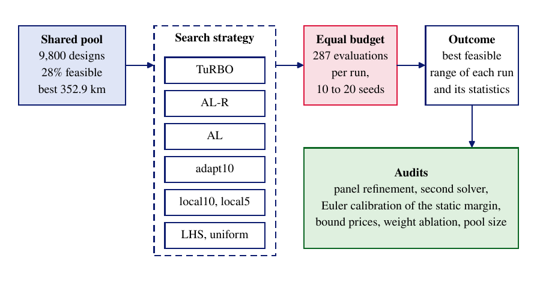
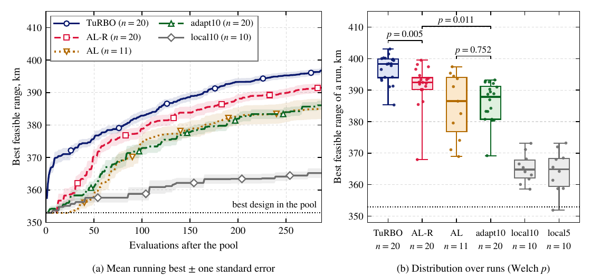
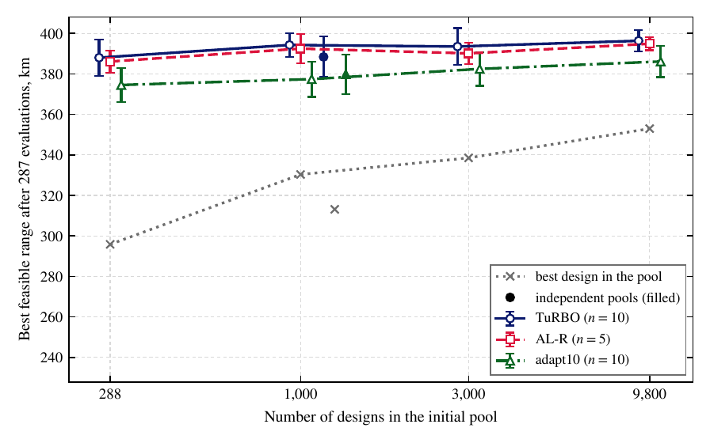
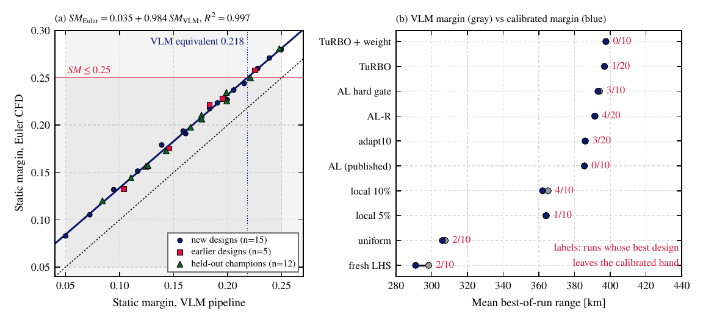
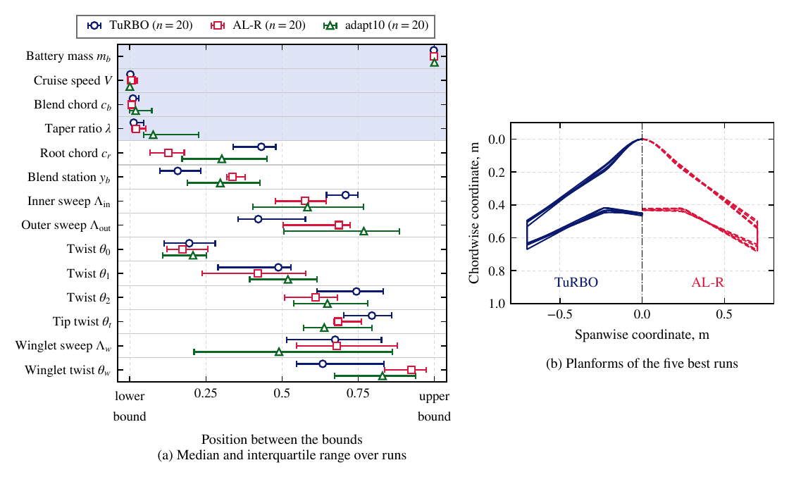

# Equal-Budget Benchmark of Surrogate-Assisted Search for a Tailless Blended-Wing-Body UAV

[](https://doi.org/10.5281/zenodo.22893592)


Code, complete run histories and manuscript sources for the preprint

> **M. Atrey**, *Equal-Budget Benchmark of Surrogate-Assisted Search Strategies for Conceptual Design of a Tailless Blended-Wing-Body UAV with an Euler-Calibrated Stability Constraint*, preprint, 2026. [doi:10.5281/zenodo.22893592](https://doi.org/10.5281/zenodo.22893592) · [PDF](docs/preprint.pdf) · [Supplement](docs/supplement.pdf)

Surrogate-assisted optimization of small aircraft is usually judged against its own initial sample, which does not show what the surrogate contributes. This study gives eight search strategies, with and without a surrogate, the **same 287 evaluations from the same 9,800-design pool**, repeats each over 10 to 20 seeds, and audits the evaluator and its stability constraint against independent models, including Euler CFD.

<p align="center"></p>

## Main results

| Strategy | Runs | Best feasible range after 287 evaluations (km) |
|---|---:|---:|
| Trust-region Bayesian optimization (TuRBO) | 20 | **396.8 ± 4.4** |
| Neural-ensemble active learning with washout repair (AL-R) | 20 | 391.5 ± 6.6 |
| Adaptive local search, no surrogate (adapt10) | 20 | 386.1 ± 6.3 |
| Neural-ensemble active learning as originally published (AL) | 11 | 385.0 ± 10.4 |
| Static local search, no surrogate (local10) | 10 | 365.2 ± 4.7 |
| Best design of the 9,800-design pool | | 352.9 |

- **A surrogate-free search gets most of the way.** Letting a simple local search follow its best designs recovers 76% of TuRBO's gain over the pool. The published active-learning loop is no better than that search; after a one-line repair of a constraint it comes second, 1.4% behind TuRBO (Holm-corrected *p* = 0.020).
- **The feasibility classifier is essential for one method and useless for the other.** Without it the active-learning loop found no feasible design in 20 runs; added to TuRBO it raised the feasible fraction but not the range.
- **The low-order stability constraint is biased.** Euler CFD on 20 designs shows the vortex-lattice static margin is low by a nearly constant 0.035; the correction was confirmed on 12 held-out designs (RMS error 0.003).
- **The large pool is mostly unnecessary.** From 288 pool designs every TuRBO run still beats the best of all 9,800; at twice the budget the ordering holds and the gaps narrow.

<p align="center"></p>

<table>
<tr>
<td width="50%"></td>
<td width="50%"></td>
</tr>
<tr>
<td><sub>Best range against the size of the initial pool.</sub></td>
<td><sub>Lattice static margin against Euler CFD, with the 12 held-out designs.</sub></td>
</tr>
</table>

<p align="center"><br><sub>Best design of every run: battery mass and cruise speed sit at their bounds; the planform is not unique.</sub></p>

## Repository layout

```
code/
  flying_wing_optimizer/     evaluator: planform loft, vortex-lattice aerodynamics, mass and mission model
  experiments/               strategy runners (TuRBO, active learning, local searches, pools) and analysis
    launchers/               shell scripts that ran each batch of experiments
  experiments_first_revision/  earlier experiment and analysis scripts
data/
  original_campaign/database.csv   10,087 evaluations of the original campaign, full design vectors
  results_revision/          first-revision runs (replications, controls, clamp and bound studies, grid, CFD)
  results_v3/                benchmark and audit runs of the current manuscript, one CSV per run
manuscript/                  LaTeX sources, tables, figures (PDF and editable SVG) and the generator scripts
docs/                        preprint, supplement, figure images and the detailed data README
```

`docs/DATA_README.md` describes every data folder. Folders without the suffix `_fix` or `_v2` hold first implementations or superseded layouts and are kept for transparency, as the manuscript explains.

## Reproducing the results

```bash
python3 -m venv .venv && source .venv/bin/activate
pip install -r requirements.txt
```

**Re-evaluate a design.** From `code/`, `flying_wing_optimizer.main.evaluate_design_vector(x, eval_id, tag)` evaluates a 14-variable design vector with the full pipeline.

**Energy basis.** The evaluator computes range with a usable energy density of 208.25 Wh/kg, a value set before the battery-pack derivation of the paper. Multiply its ranges by 203.3/208.25, and the stored database and run-history ranges (160 Wh/kg basis) by 203.3/160, to obtain the ranges reported in the paper. With that conversion, re-evaluating the best design of the original campaign reproduces the stored value within five parts per million.

**Regenerate every number, table and figure.** The generator scripts in `manuscript/` read the run files; set the paths at the top of each script to this repository, then run, in order:

```
make_numbers.py  make_paper_figures.py  make_fig_planform.py  make_numbers_v4.py  make_numbers_pool.py
make_figures_v5.py  make_numbers_long.py  make_figures_bench.py  make_fig_architecture.py  make_fig_trim.py
```

and compile `supplement.tex` and `main_revised.tex` twice each (any LaTeX engine; the author used Tectonic).

**Rerun an experiment.** The runners in `code/experiments/` take an output folder and a seed range. From `code/experiments/`:

```bash
DRONE_ROOT=$(cd .. && pwd) NPROC=2 TBUDGET=100000 python3 turbo_arm_v4.py OUTDIR 0 1
```

`DRONE_ROOT` points to `code/` (the runners read the pool from `code/flying_wing_optimizer/results/database.csv`, a link to `data/original_campaign/database.csv`). `TBUDGET` is a wall-clock limit in seconds; a run stopped by it resumes from its CSV when started again. The launchers in `code/experiments/launchers/` show the exact settings of every batch. A 287-evaluation run takes from about fifteen minutes (local search) to about an hour (TuRBO) on a laptop. A rerun of TuRBO seed 0 reproduces the first evaluations of `data/results_v3/turbo_fix/turbo_seed0.csv` exactly.

The SU2 Euler solution files (about 400 MB) are not in this repository; they are in the Zenodo record.

## Citation

```bibtex
@misc{atrey2026equalbudget,
  author    = {Atrey, Mudit},
  title     = {Equal-Budget Benchmark of Surrogate-Assisted Search Strategies for Conceptual Design of a
               Tailless Blended-Wing-Body {UAV} with an {Euler}-Calibrated Stability Constraint},
  year      = {2026},
  publisher = {Zenodo},
  note      = {Preprint},
  doi       = {10.5281/zenodo.22893592}
}
```

## Licence

Code: [MIT](LICENSE). Data, figures and manuscript text: [CC BY 4.0](LICENSE-DATA.md).
